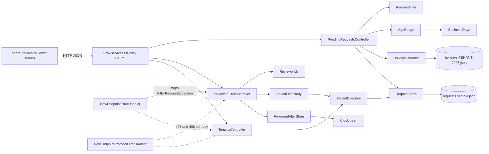
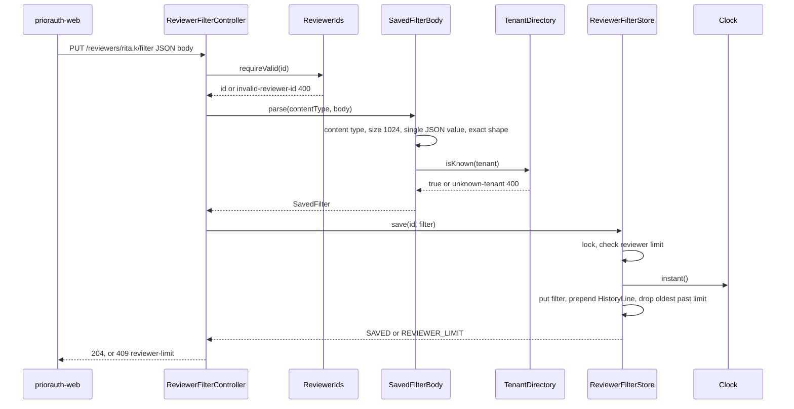
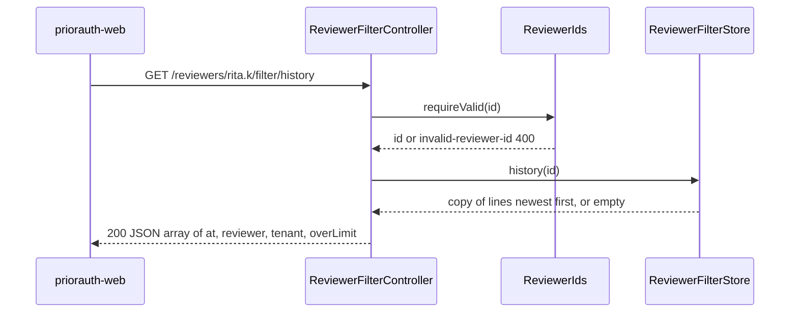
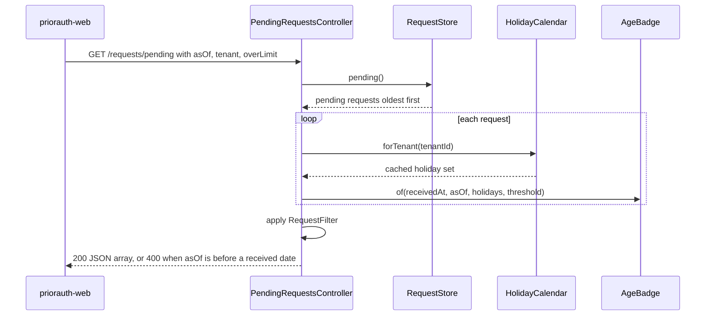

# Architecture: priorauth-api

Full rescan of `main` at `0e00544` (tag `v1.2.0`), 2026-11-03.

## Architecture Analysis

### System Overview

One Spring Boot 4.1 web application (Java 21, single Maven module) serving five JSON endpoints over embedded Tomcat on port 8080. Data comes from two packaged classpath files (the request export and a holiday list) loaded at start-up or on first use; reviewer filters and their history are held in one in-memory store. There is no database, no message broker, no outbound call and no authentication.

### Architectural Style

Layered monolith with package-by-layer plus one feature package:

- `api`: HTTP boundary (controllers, request parsing and validation, response records, error mapping, CORS).
- `aging`: domain logic for request age (pure functions plus a cached holiday loader).
- `store`: data access (read-only export, derived tenant directory, mutable in-memory filter store).
- `model`: domain records.

Evidence: imports point one way only, `api -> aging, store, model` and `store -> model`; `aging` and `model` import no application package; HTTP types (`ResponseStatusException`, `HttpStatus`, `MediaType`) appear only in `api`. No cycles.

### Component Relationships

Text fallback:
- The screen calls the API over HTTP; `BrowserAccessPolicy` allows browser calls only from named origins.
- `PendingRequestsController` reads `RequestStore`, ages each pending request with `AgeBadge` / `BusinessDays` and the tenant's `HolidayCalendar`, then applies `RequestFilter`.
- `ReviewerFilterController` validates the id with `ReviewerIds`, parses the body with `SavedFilterBody` (which checks the tenant against `TenantDirectory`), and saves or reads through `ReviewerFilterStore`, which stamps history lines from the `Clock` bean.
- `TenantsController` lists `TenantDirectory`, which is derived from `RequestStore`.
- `RequestStore` reads `requests.sample.json`; `HolidayCalendar` reads `holidays-<tenant>-2026.json`.
- `NewEndpointErrorHandler` turns `FilterRequestException` into the contract error body for the two new controllers; `NewEndpointProtocolErrorHandler` answers 405/406 on `/reviewers/**` and `/tenants` with no body.

### Data Flow

- **Start-up**: Spring builds `RequestStore` (reads and sorts the export once; failure stops start-up), then `TenantDirectory` (distinct sorted tenant ids), `ReviewerFilterStore` (validates both limits at least 1), `BrowserAccessPolicy` (fails start-up on `*`, `null` or an empty origin) and the UTC `Clock` bean.
- **Read path (queue)**: request export (memory) -> pending filter -> age per row with cached holidays -> response record (no `memberId`) -> query filter -> JSON array.
- **Write path (filter)**: raw body stream (at most 1,024 bytes read) -> JSON tree -> `SavedFilter` -> one lock: replace filter and prepend history line -> 204.
- **Read path (filter, history)**: id check -> one lock: copy -> response records -> JSON.

### Key Design Decisions

| Decision | Where | Implication |
|---|---|---|
| In-memory store with one `synchronized` lock for filter and history (ADR-001, C6, US5163 NFR2) | `ReviewerFilterStore` | A save and its history line are atomic; all filter traffic is serialised; state is lost on restart and not shared across instances. |
| Raw-body parsing by hand on a `JsonNode` in a fixed check order (FR1.6) | `SavedFilterBody` | Spring binding and Jackson coercion cannot loosen the contract; error precedence is deterministic. |
| Fixed error bodies, scoped advice for the new controllers, global path-matched advice for 405/406 (ADR-003, NFR4) | `NewEndpointErrorHandler`, `NewEndpointProtocolErrorHandler` | New endpoints never echo caller input; `GET /requests/pending` keeps Spring Boot's default error body. |
| Known tenants derived from the export (ADR-002) | `TenantDirectory` | No separate tenant source; adding a tenant means a new export row. |
| Named CORS origins only, start-up refusal of `*` (ADR-006) | `BrowserAccessPolicy` | Misconfiguration fails fast. |
| Injected UTC `Clock` bean (US5163 NFR9) | `PriorAuthApiApplication` | History times are testable with `MutableClock`; the queue's default date does not use it yet. |
| Response records separate from domain records | `api/*Response` | Domain records are never serialised directly. |

### Improvement Opportunities

- Persist filters and history, and add authentication, before any shared deployment (both absent by decision for F1220).
- Use the `Clock` bean for the queue's default as-of date, and load holidays by the year of the dates being aged (see `code-quality-assessment.md`, TD-1 and TD-3).
- Size `max-reviewers` x `max-history-lines` against the heap (TD-4).

## Interaction Diagrams

### Save a filter (US5160 C1, with the US5163 history line)

Text fallback: the controller checks the reviewer id, then the body parser checks content type, size, JSON shape and a known tenant, in that order; any failure answers 400 with a fixed body and stores nothing. The store, under one lock, refuses a new reviewer beyond the limit (409), otherwise replaces the filter and prepends a history line stamped from the clock, then the controller answers 204.

### Read the history (US5163 C3)

Text fallback: the id is checked; the store returns an immutable copy of the reviewer's lines under the lock (empty when they never saved, and the read stores nothing); each line maps to `HistoryLineResponse` with `at` as ISO-8601 UTC; the answer is 200 with a JSON array.

### Read the pending queue

Text fallback: the controller takes the pending requests, ages each one against its tenant's cached holidays and the threshold, filters by tenant and over-limit when asked, and returns the rows; an as-of date before a received date becomes 400.
