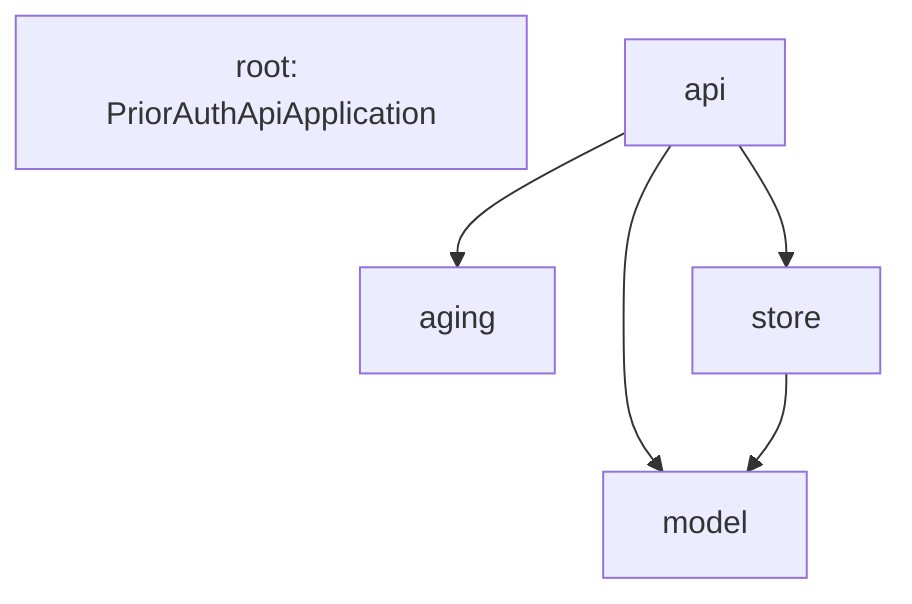

# Dependencies: priorauth-api

Full rescan of `main` at `0e00544` (tag `v1.2.0`), 2026-11-03.

## External Dependencies

| Artifact | Scope | Why (POM comment) |
|---|---|---|
| `org.springframework.boot:spring-boot-starter-parent:4.1.1` | parent | Tested versions of Spring Boot and its libraries; no other version numbers in the POM |
| `org.springframework.boot:spring-boot-starter-webmvc` | compile | Spring MVC + embedded Tomcat + JSON |
| `org.springframework.boot:spring-boot-starter-webmvc-test` | test | JUnit 5, AssertJ and MockMvc |
| `org.springframework.boot:spring-boot-maven-plugin` | build plugin | `mvn spring-boot:run` and one runnable jar |

No other runtime dependency; no outbound network calls; no database driver. Library versions are in `technology-stack.md`. No dependency was checked against security advisories in this run.

## Internal Package Dependencies

Text fallback: `api` depends on `aging`, `store` and `model`; `store` depends on `model`; `aging`, `model` and the root import no application package. No cycles. HTTP types stay in `api`.

## Class-level Adjacency (main source)

- `PendingRequestsController` -> RequestStore, HolidayCalendar, AgeBadge, RequestFilter, PendingRequestResponse
- `ReviewerFilterController` -> ReviewerFilterStore, TenantDirectory, ReviewerIds, SavedFilterBody, SavedFilterResponse, HistoryLineResponse, FilterRequestException, ErrorCode
- `TenantsController` -> TenantDirectory
- `SavedFilterBody` -> SavedFilter, TenantDirectory, FilterRequestException, ErrorCode
- `ReviewerIds`, `ErrorResponse`, `FilterRequestException` -> ErrorCode
- `NewEndpointErrorHandler` -> FilterRequestException, ErrorCode, ErrorResponse (scoped to ReviewerFilterController, TenantsController)
- `PendingRequestResponse` -> PriorAuthRequest, AgeBadge; `SavedFilterResponse` -> SavedFilter; `HistoryLineResponse` -> HistoryLine; `RequestFilter` -> PendingRequestResponse
- `AgeBadge` -> BusinessDays
- `TenantDirectory` -> RequestStore, PriorAuthRequest; `RequestStore` -> PriorAuthRequest; `ReviewerFilterStore` -> SavedFilter, HistoryLine, `Clock` bean (from PriorAuthApiApplication)

## Runtime Inputs

| Input | Read by | When |
|---|---|---|
| `classpath:data/requests.sample.json` | RequestStore | Start-up |
| `classpath:data/holidays-<tenant>-2026.json` | HolidayCalendar | First request for that tenant |
| `application.yml` keys under `priorauth.` | controllers, stores, BrowserAccessPolicy | Start-up (keys listed in `api-documentation.md`) |

## Cross-repo Dependency

`priorauth-web` (sibling repo) is the only known consumer; it calls all five endpoints from the allowed origin. Changes to C1-C5 need a matching PR in `priorauth-web` (one PR per repo, each naming the other).
