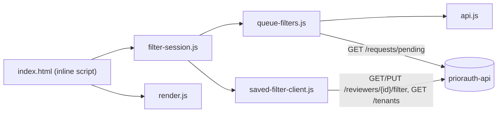
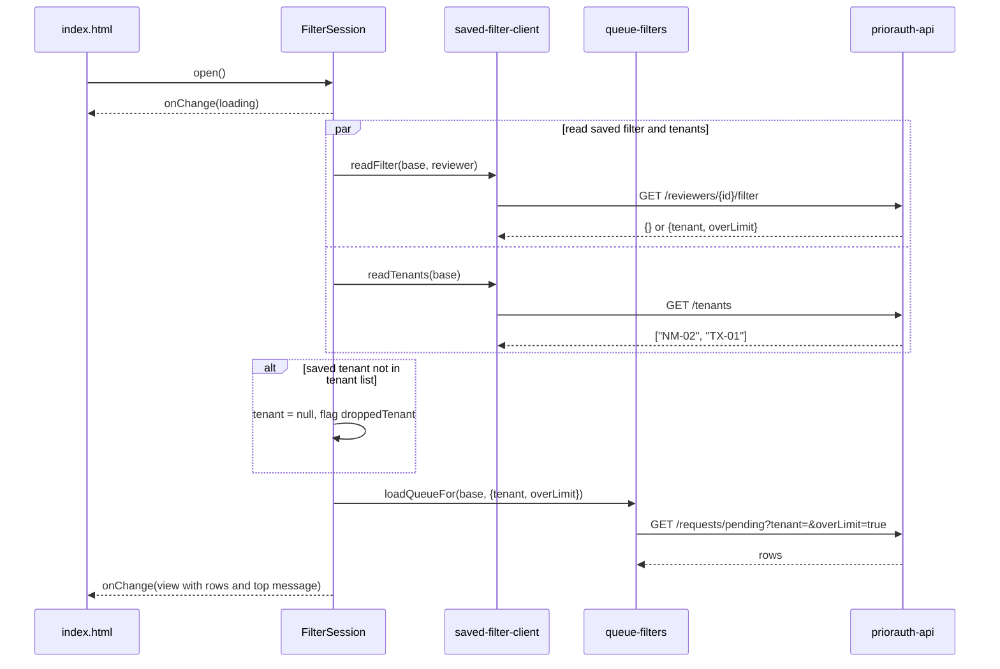
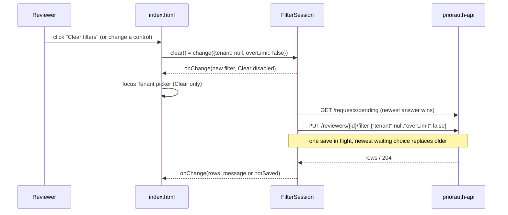

# Architecture: priorauth-web

## Architecture Analysis

### System Overview

A static, single-page browser client with no build step. `index.html` holds markup, CSS and a thin inline module script, the only code that touches the DOM. All logic lives in DOM-free ES modules under `src/`, each with its own test file. The page talks directly from the browser to `priorauth-api` over HTTP (CORS must allow the page's origin).

### Architectural Style

Static front end, client of a separate monolithic API. Inside the page, a layered "functional core, thin shell" design:

- **Shell**: `index.html` inline script (DOM reads/writes, event listeners).
- **State/orchestration**: `src/filter-session.js` (`createFilterSession`, the FilterSession of ADR-004).
- **Rendering**: `src/render.js` (pure string builders; the QueueRenderer).
- **API clients**: `src/queue-filters.js`, `src/saved-filter-client.js`, `src/api.js` (URL builders plus `fetch` with an injected `fetchFn`).

Evidence: README ("no build step, no dependencies"), `package.json` (no dependencies), `team.md` Code Style for `priorauth-web`.

### Component Relationships

Text fallback: `index.html` imports `filter-session.js` and `render.js`. `filter-session.js` imports `queue-filters.js` and `saved-filter-client.js`. `queue-filters.js` imports `api.js` (for `pendingUrl`). Only `queue-filters.js` and `saved-filter-client.js` make HTTP calls to `priorauth-api`. No cycles.

### Data Flow

1. The page reads `?api=` and `?reviewer=` and writes the controls once (`renderControls`).
2. `createFilterSession` holds one view: `{loading, tenants, tenant, overLimit, rows, message}`. Every state change calls `publish()`, which picks the top message and hands a copy of the view to the page's `onChange`.
3. `onChange` updates the controls through DOM properties (focus stays put, NFR10), sets the Clear button's `disabled` from `filterIsSet`, and writes the rows and count from `render.js`.
4. Control events and the Clear button call `session.change(...)` / `session.clear()`; the session asks the queue, retries the tenant list if it had failed, and queues a save when a reviewer is known.

Message priority (FR4.9, highest first): `queue`, `notSaved`, `tenants`, `savedFilter`, `droppedTenant`, `notRemembered` (`filter-session.js:17`).

### Key Design Decisions

- **DOM-free `src/`, thin `index.html`**: all logic is testable under `node --test`; the inline script is not tested by rule.
- **Injected `fetchFn = fetch`** as the last parameter of every network function; `filter-session.js` wraps it with a 10 s `AbortSignal.timeout`.
- **Newest queue answer wins** (`queueAsked` counter); older answers are dropped.
- **Single-flight save with replace-waiting** (FR5.3).
- **Late saved-filter read ignored** once the reviewer changed a control (`changed` flag, R-06).
- **Clear reuses `change`** (US5162 A3): Clear is a change to `{tenant: null, overLimit: false}`, so it inherits the queue, save and message behaviour.
- **Contract validation at the boundary**: `savedFilterFrom` and `tenantListFrom` reject answers outside C1/C2 and treat them as failures.
- **One shared escape helper** (`esc` in `render.js`) for every rendered value (NFR5).

### Improvement Opportunities

Recorded once in [code-quality-assessment.md](code-quality-assessment.md) (duplicated non-2xx handling, unused `fetchPending`, stale README tail, no lint/CI/coverage).

## Interaction Diagrams

### Open the screen with a reviewer (US5161, US5162 FR4.10)

Text fallback: `open()` publishes a loading view, reads the saved filter and the tenant list in parallel, drops a saved tenant the list does not hold (dropped-tenant message, nothing saved), and only then asks for the queue so the unfiltered queue never shows first. A failed or off-contract read opens unfiltered with the saved-filter message. Without a reviewer, only the tenants and the queue are asked and the not-remembered message shows.

### Change a control or Clear filters (US5161 AC1.2.5, US5162 AC1.3.1)

Text fallback: a control change or Clear updates the view at once, then asks the queue and (with a reviewer) queues a save. If a save is already open, the new filter waits and replaces any older waiting filter, so the cleared filter is always saved last (AC1.3.6). A failed save keeps the filter on screen with the not-saved message (AC1.3.4). Without a reviewer nothing is saved.
