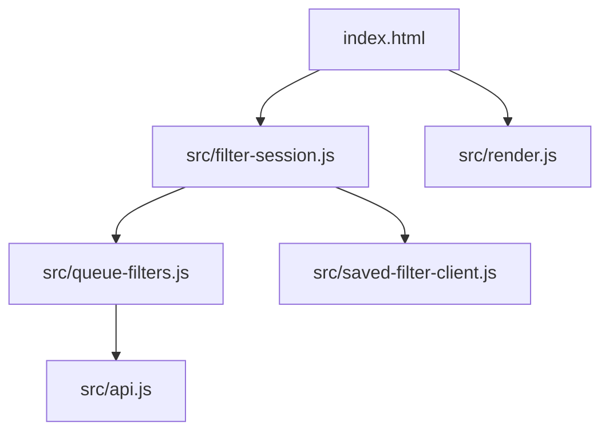

# Dependencies: priorauth-web

## External Package Dependencies

None. `package.json` declares no `dependencies` and no `devDependencies`; `node_modules/` is gitignored and not needed. The only external tool used is `serve@14`, fetched by `npx` for the local demo and not declared.

## Platform Dependencies

- Node.js `>=20` for `node:test`, `node:assert/strict`, `node:fs` (tests only).
- Browser `fetch`, `URL`, `URLSearchParams`, `AbortSignal.timeout`, `encodeURIComponent`.

## Service Dependencies

- `priorauth-api` over HTTP from the browser: `GET /requests/pending`, `GET`/`PUT /reviewers/{reviewerId}/filter`, `GET /tenants` (contracts in [api-documentation.md](api-documentation.md)). The API must allow the page's origin via CORS.

## Internal Cross-Module Dependencies

Text fallback: `index.html` -> `filter-session.js`, `render.js`; `filter-session.js` -> `queue-filters.js`, `saved-filter-client.js`; `queue-filters.js` -> `api.js`. Each test file imports only its own `src/` module (plus `node:fs` for contract examples). No circular imports.
