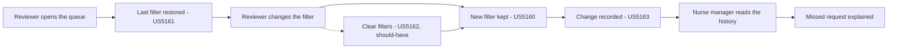

# Scope Document — F1220 Remember my filter

Builds on the approved intent statement (`ideation/intent-capture/intent-statement.md`). Answers cited as [Q<n>] are from `scope-definition-questions.md` in this folder. Answers cited as [intent Q<n>] are from `ideation/intent-capture/intent-capture-questions.md`.

## Goal

Reviewers stop re-picking their queue filter every day, and nurse managers can explain why a reviewer did not see a request. (Intent statement: Problem Statement, Success Metrics.)

## Minimum Viable Scope

The feature delivers its value only when all three must-have stories ship together. [Q1]

- A reviewer's last filter is kept and can be read back (US5160).
- The reviewer's screen opens with that filter applied (US5161).
- Every filter change is recorded and can be read back as a history (US5163).

Clearing all filters with one control (US5162) adds convenience but is not needed for the value. It is a should-have, as decided by Dana Ortiz. [Q1]

## In Scope

| Capability | Story | Priority | Source |
|---|---|---|---|
| Keep each reviewer's last filter (tenant and over-limit) so it follows them to any browser | US5160 | Must | [Q1]; intent: Target Customer |
| Open the reviewer's screen with their last filter applied; with no saved filter it opens unfiltered, as today | US5161 | Must | [Q1]; intent: Success Metrics |
| Record every filter change (when, who, what) and show a reviewer's history, newest first | US5163 | Must | [Q1]; intent: Success Metrics |
| One control that clears the tenant and the over-limit switch | US5162 | Should | [Q1] |
| A release-notes line, written by Meena Iyer, saying the filter history is lost when the service restarts and that anyone using the screen can read it | — | Must | intent: Initial Scope Signal; [intent Q11]; [Q6] |

## Out of Scope (this version)

| Excluded | Why / consequence | Source |
|---|---|---|
| A durable store for filters and history | Lost on restart; accepted, and stated in the release notes | intent: Initial Scope Signal [intent Q8] [intent Q9] |
| Sign-in | The reviewer is identified by the login name the screen passes along | intent: Initial Scope Signal [intent Q8] |
| Limiting who may read a reviewer's filter history | Anyone using the screen can read it; accepted as a known limit and stated in the release notes | [Q6] |
| More than one saved filter per reviewer, or filter fields beyond tenant and over-limit | Later features | intent: Initial Scope Signal [intent Q8] |
| Exporting the history or keeping it for a set retention period | Later features | intent: Initial Scope Signal [intent Q8] |
| A time-to-first-review metric | No baseline is taken for this release | intent: Success Metrics [intent Q3] |

## Sequencing and Dependencies

The guiding principle is dependency-first: agree how the screen and the service talk to each other, then build the saved-filter story before anything that relies on it. [Q4]

| Story | Depends on | Can start | Source |
|---|---|---|---|
| US5160 Save and read the last filter | — | First | [Q3] |
| US5161 Open the screen with my last filter | The agreed contract (Divya Pillai and Kiran Rao agree it in Contract Design) | As soon as the contract is agreed; it does not wait for US5160 to merge | [Q3] |
| US5163 Audit every filter change | US5160 (it records what US5160 saves) | After US5160 | [Q3] |
| US5162 Clear my filters | US5161 (the same screen) | After US5161 | [Q3] |

## Deadline and Trade-off

- The whole feature is due in release 2027.Q1 R1. No story has an earlier milestone. [Q5]
- If the date is at risk, US5162 Clear my filters is the first to slip to a later release. Reviewers can still clear each control by hand. [Q2]

## Value Stream

Text version:

1. A reviewer opens the queue and their last filter is restored (US5161).
2. When they change it, the new filter is kept (US5160) and the change is recorded (US5163).
3. A nurse manager reads that history to explain a missed request.
4. Clearing all filters (US5162) is another way to change the filter, and goes through the same path.

## Assumptions & Open Questions

None.
