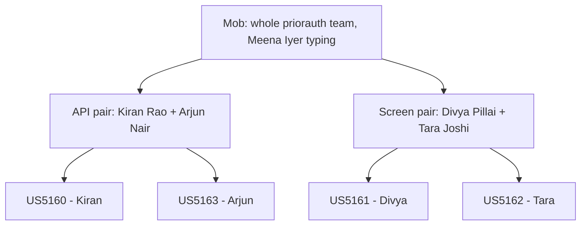

# Mob Composition — F1220 Remember my filter

Answers cited as [Q<n>] are from `team-formation-questions.md` in this folder.

## How the Team Works Together

| When | Who | How | Source |
|---|---|---|---|
| The feature's Inception decisions (requirements through delivery plan) | The whole team: Meena Iyer, Kiran Rao, Divya Pillai, Tara Joshi, Arjun Nair; Dana Ortiz for scope decisions | One mob session on one call. Meena Iyer shares her screen and types. The room's decision is recorded with the names of who decided. | [Q4] [Q5] [Q7] |
| Review of each story's code plan, before code is written | The whole team | Mob review on one call | [Q4] [Q5] |
| Building each story | The story's owner | Builds their own story and opens its pull request | [Q4] [Q7] |
| API stories (US5160, US5163) | Kiran Rao with Arjun Nair | Pair | [Q4] |
| Screen stories (US5161, US5162) | Divya Pillai with Tara Joshi | Pair | [Q4] |

## Mobs and Pairs

Text version:

- The whole team works as one mob for the Inception decisions and the code-plan reviews. [Q4]
- Two pairs cover the two parts of the product: Kiran with Arjun on the API, Divya with Tara on the screen. [Q4]
- Each pair holds two stories, each with its own owner. [Q4]; intent backlog

## Session Logistics

- Everyone is in one time zone (IST) and works remotely. [Q5]
- Mob sessions run on one call, with Meena Iyer sharing her screen. [Q5]

## Assumptions & Open Questions

None.
