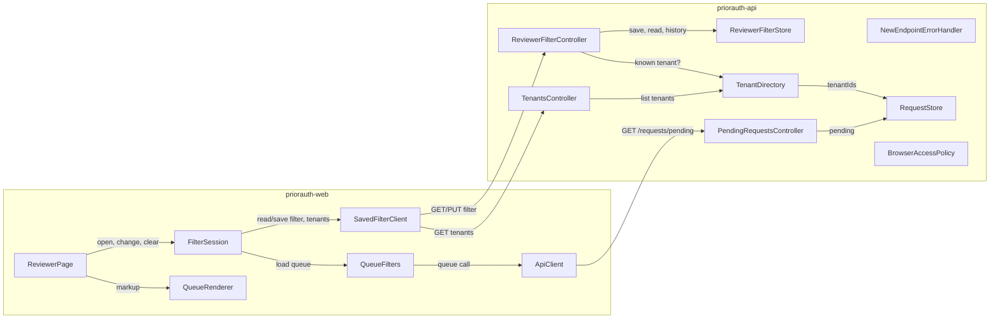

# Components — F1220 Remember my filter

The building blocks F1220 adds or changes, across `priorauth-api` and `priorauth-web`.

- **Inputs:**
  - `requirements.md`, `stories.md` (approved)
  - `codekb/*/component-inventory.md`
  - `domain-design-questions.md` (Q1-Q4, confirmed)
- **Existing components:** only those F1220 touches or depends on appear here. `HolidayCalendar`, `BusinessDays`, `AgeBadge`, `RequestFilter` and `PendingRequestResponse` are unchanged. They stay behind `PendingRequestsController`, as `codekb/priorauth-api/component-inventory.md` describes.
- **What stays for later stages:** deployment grouping is decided in Units Generation, and wire shapes are fixed in Contract Design.

## Component Catalogue

```yaml
components:
  # ---------- priorauth-api ----------
  - name: ReviewerFilterController
    summary: New. Serves PUT/GET /reviewers/{reviewerId}/filter and GET /reviewers/{reviewerId}/filter/history.
    behaviour: >
      Validates the reviewer id at the boundary: 1-64 ASCII characters from letters, digits, '.', '-' and '_',
      with at least one letter or digit, case-sensitive (FR1.3, Q6). Rejects bodies over 1,024 bytes, missing
      or extra fields, and wrong types; Spring's lenient JSON defaults are switched off for these requests
      (AC1.1.6). Checks the tenant against TenantDirectory before asking the store to save. A tenant that is
      null means all tenants. Maps a caller error to 400 and the reviewer limit to the 4xx that Contract Design
      fixes. Never echoes caller input in an error (NFR4). Reads never create a reviewer entry (FR1.4).
    responsibilities:
      - HTTP binding, reviewer-id and body validation for the three /reviewers endpoints
      - Mapping store outcomes to 204 / 200 / 400 / the limit error
    depends_on:
      - component: ReviewerFilterStore
        interaction: save a filter with its history line, read the last filter, read the history
        style: sync
      - component: TenantDirectory
        interaction: check that a saved tenant is known
        style: sync
    dependents:
      - component: SavedFilterClient
        interaction: the screen reads and saves the reviewer's filter over REST
    external_dependencies: []
    entities: []

  - name: TenantsController
    summary: New. Serves GET /tenants, the known tenants for the screen's picker (Q4).
    behaviour: >
      Read-only. Answers the known tenants in a stable order. Takes no caller input that reaches a file path or
      cache key. Contract Design fixes the response shape.
    responsibilities:
      - HTTP binding for GET /tenants
    depends_on:
      - component: TenantDirectory
        interaction: list the known tenants
        style: sync
    dependents:
      - component: SavedFilterClient
        interaction: the screen loads the picker's tenant list over REST
    external_dependencies: []
    entities: []

  - name: NewEndpointErrorHandler
    summary: New. One error handler scoped to ReviewerFilterController and TenantsController.
    behaviour: >
      Turns refused requests on the new endpoints into the safe error body Contract Design fixes: a short
      message, no stack trace, no caller-supplied tenant or reviewer id (NFR4, AC1.1.10, AC1.4.8). Its scope
      is limited to the two new controllers, so GET /requests/pending keeps its current error behaviour
      (AC1.1.13). Applied by the framework, not called by other components.
    responsibilities:
      - Safe, uniform error bodies for the new endpoints only
    depends_on: []
    dependents: []
    external_dependencies: []
    entities: []

  - name: ReviewerFilterStore
    summary: New. The one in-memory store for saved filters and their history (Q1, NFR1).
    behaviour: >
      A save replaces the reviewer's last filter and appends exactly one history line, together, under one lock
      per store: both happen or neither does (NFR2, AC1.4.7). A save that would add a new reviewer beyond the
      reviewer limit (default 10,000) is refused before anything changes (FR1.4). Each reviewer's history keeps
      only the newest lines up to the history limit (default 1,000), dropping the oldest when a line is added
      (FR7.5). History is read newest first; lines in the same second keep save order, newest first (FR7.3).
      Line time comes from an injected clock, in UTC, cut to the second (NFR9, AC1.4.1). Reads never add a
      reviewer. Both limits are configurable (A3). Holds no Spring web types; it is the class a later feature
      replaces with a durable store.
    responsibilities:
      - Last saved filter per reviewer
      - Filter history per reviewer, bounded
      - Atomic save of a filter together with its history line
      - Reviewer and history limits
    depends_on: []
    dependents:
      - component: ReviewerFilterController
        interaction: save, read last filter, read history
    external_dependencies:
      - name: Injected clock (java.time.Clock)
        kind: other
        purpose: the time of each history line; tests control it
    entities:
      - name: SavedFilter
        identifier: reviewerId
        attributes: [reviewerId, tenant, overLimit]
        references:
          - entity: KnownTenant
            owned_by: TenantDirectory
            relationship: a saved tenant is one known tenant, or null for all tenants
      - name: FilterHistoryLine
        identifier: reviewerId + sequence
        attributes: [at, reviewer, tenant, overLimit, sequence]
        references:
          - entity: SavedFilter
            owned_by: ReviewerFilterStore
            relationship: each line records one successful save of that reviewer's filter

  - name: TenantDirectory
    summary: New. Knows which tenants exist: every tenantId in the request export (FR3.1, Q2).
    behaviour: >
      Built once from RequestStore at start-up. Answers "is this tenant known?" with an exact, case-sensitive
      match (A4) and lists the known tenants in a stable order. Never builds a file path or cache key from a
      caller's value, and never calls HolidayCalendar.
    responsibilities:
      - The set of known tenants
    depends_on:
      - component: RequestStore
        interaction: read every request's tenantId once
        style: sync
    dependents:
      - component: ReviewerFilterController
        interaction: validate a saved tenant
      - component: TenantsController
        interaction: list the known tenants
    external_dependencies: []
    entities:
      - name: KnownTenant
        identifier: tenantId
        attributes: [tenantId]
        references:
          - entity: PriorAuthRequest
            owned_by: RequestStore
            relationship: a tenant is known because at least one request in the export carries its id

  - name: RequestStore
    summary: Existing. Loads the request export; US1.1 adds an NM-02 request to the sample export (FR3.2).
    behaviour: >
      Unchanged in purpose: loads classpath data/requests.sample.json once, sorted, and serves all() and
      pending(). Only its sample data changes.
    responsibilities:
      - The request export
    depends_on: []
    dependents:
      - component: TenantDirectory
        interaction: source of the known tenants
      - component: PendingRequestsController
        interaction: pending requests for the queue
    external_dependencies:
      - name: classpath data/requests.sample.json
        kind: other
        purpose: the bundled request export
    entities:
      - name: PriorAuthRequest
        identifier: id
        attributes: [id, tenantId, memberId, service, status, receivedAt]

  - name: PendingRequestsController
    summary: Existing, unchanged. Serves GET /requests/pending (FR3.3).
    behaviour: >
      Keeps answering 200 [] for an unknown tenant. Its error behaviour is untouched by NewEndpointErrorHandler.
      Browser calls to it are covered by BrowserAccessPolicy.
    responsibilities:
      - The pending queue with tenant and over-limit filters
    depends_on:
      - component: RequestStore
        interaction: pending requests
        style: sync
    dependents:
      - component: ApiClient
        interaction: the screen loads the queue over REST
    external_dependencies: []
    entities: []

  - name: BrowserAccessPolicy
    summary: New. The API's browser-origin (CORS) settings for the new endpoints and GET /requests/pending (NFR6).
    behaviour: >
      Allows browser calls, including the PUT preflight, only from configured, named origins (the screen's
      local development origin by default). Never answers '*'. Applied by the framework, not called by other
      components.
    responsibilities:
      - Which browser origins may call the API
    depends_on: []
    dependents: []
    external_dependencies: []
    entities: []

  # ---------- priorauth-web ----------
  - name: ReviewerPage
    summary: Existing, changed. index.html, the only DOM-touching code; stays a thin caller (team practice).
    behaviour: >
      Reads ?reviewer= and ?api=. Renders the controls and the message area from QueueRenderer output, passes
      control changes to FilterSession, and writes what FilterSession decides. Holds no filter logic of its own.
    responsibilities:
      - Wiring the DOM to FilterSession and QueueRenderer
    depends_on:
      - component: FilterSession
        interaction: every open, change and clear goes through the session
        style: sync
      - component: QueueRenderer
        interaction: markup for rows, controls and messages
        style: sync
    dependents: []
    external_dependencies: []
    entities: []

  - name: FilterSession
    summary: New. DOM-free logic for restoring, saving and clearing the filter (Q4).
    behaviour: >
      On open: shows the loading state, reads the saved filter, then asks the queue, so the unfiltered queue is
      never shown first (AC1.2.2). With no reviewer, filters without reading or saving (A1). Sends saves one at
      a time: a newer choice waits, and a waiting save is replaced by an even newer one (FR5.3, AC1.2.7). A
      change before the saved filter arrives wins, and the late read is ignored (R-06, AC1.2.8). Only the
      latest queue answer is shown. Decides the single message: saved filter couldn't be loaded, filter wasn't
      saved, filter won't be remembered, queue couldn't be loaded, or none. A "wasn't saved" message clears on
      the next successful save (AC1.2.4-AC1.2.12). Clear sets all tenants and switch off and saves; Clear is
      disabled when nothing is set (FR6). US1.3 changes only this module and QueueRenderer (Q4).
    responsibilities:
      - Ordering of saves and handling of late answers
      - The current filter choice and the message to show
      - Clear-filters behaviour
    depends_on:
      - component: SavedFilterClient
        interaction: read and save the reviewer's filter, read the tenants
        style: async
      - component: QueueFilters
        interaction: load the queue for the current filter
        style: async
    dependents:
      - component: ReviewerPage
        interaction: open, change, clear
    external_dependencies: []
    entities:
      - name: FilterChoice
        identifier: reviewer
        attributes: [reviewer, tenant, overLimit, saveInFlight, waitingSave, message]
        references:
          - entity: SavedFilter
            owned_by: ReviewerFilterStore
            relationship: the screen's choice is restored from, and saved as, the reviewer's saved filter

  - name: SavedFilterClient
    summary: New. DOM-free REST client for the saved filter and the tenant list.
    behaviour: >
      Reads and saves the filter for a reviewer, and reads the known tenants, with an injected fetchFn. A
      non-2xx answer throws a plain Error naming the service and status (team practice). Sends the filter
      exactly as the contract defines it.
    responsibilities:
      - Calls to /reviewers/{reviewerId}/filter and /tenants
    depends_on:
      - component: ReviewerFilterController
        interaction: GET/PUT the reviewer's filter
        style: sync
      - component: TenantsController
        interaction: GET the known tenants
        style: sync
    dependents:
      - component: FilterSession
        interaction: read and save the filter, read the tenants
    external_dependencies: []
    entities: []

  - name: QueueFilters
    summary: Existing, changed. Builds and loads the queue request for a filter.
    behaviour: >
      Keeps building GET /requests/pending with tenant and overLimit. Maps the F1210 option overLimitOnly to the
      contract's overLimit in this one place (OQ3); off is sent by leaving the parameter out, as today.
    responsibilities:
      - The queue request for the current filter
    depends_on:
      - component: ApiClient
        interaction: base URL and the fetch-and-throw call
        style: sync
    dependents:
      - component: FilterSession
        interaction: load the queue for the current filter
    external_dependencies: []
    entities: []

  - name: ApiClient
    summary: Existing, unchanged. Base REST call to GET /requests/pending.
    behaviour: >
      Builds the pending URL and turns a non-2xx answer into a thrown Error carrying the status.
    responsibilities:
      - The base queue call
    depends_on:
      - component: PendingRequestsController
        interaction: GET /requests/pending
        style: sync
    dependents:
      - component: QueueFilters
        interaction: the queue call with filters
    external_dependencies: []
    entities: []

  - name: QueueRenderer
    summary: Existing, extended. Renders rows, count, the filter controls and the message area as escaped strings.
    behaviour: >
      Every rendered value goes through esc, which escapes & < > " and ' (NFR5, AC1.2.10). Renders a labelled
      native select ("Tenant", with "All tenants" plus the known tenants), a labelled native checkbox ("Over
      limit only"), a native "Clear filters" button with the disabled attribute when nothing is set, the single
      role="status" message area, and "No requests match this filter" for an empty queue (AC1.2.1, AC1.2.11,
      AC1.3.2).
    responsibilities:
      - Markup for rows, count, controls, messages and the empty result
    depends_on: []
    dependents:
      - component: ReviewerPage
        interaction: markup for the page
    external_dependencies: []
    entities: []
```

## Component Diagram



Text version:

- **Screen side:**
  - The screen (ReviewerPage) hands every open, change and clear to FilterSession, and gets its markup from QueueRenderer.
  - FilterSession uses SavedFilterClient for the saved filter and the tenants, and QueueFilters (through ApiClient) for the queue.
- **API side:**
  - SavedFilterClient calls ReviewerFilterController and TenantsController.
  - Both controllers use TenantDirectory, which reads RequestStore once.
  - ReviewerFilterController saves and reads through ReviewerFilterStore.
  - The existing queue path (ApiClient → PendingRequestsController → RequestStore) is unchanged.
- **Applied by the framework:** NewEndpointErrorHandler and BrowserAccessPolicy are applied around the endpoints and are not called by other components.

## Component Summary

| Component | Repo | Purpose | Depends On | Dependents | Entities Owned |
|---|---|---|---|---|---|
| ReviewerFilterController | api | New: filter and history endpoints, boundary validation | ReviewerFilterStore, TenantDirectory | SavedFilterClient | — |
| TenantsController | api | New: GET /tenants | TenantDirectory | SavedFilterClient | — |
| NewEndpointErrorHandler | api | New: safe error bodies for the new endpoints only | — | — (framework) | — |
| ReviewerFilterStore | api | New: one store for saved filters and history, atomic save, limits | — | ReviewerFilterController | SavedFilter, FilterHistoryLine |
| TenantDirectory | api | New: known tenants from the export | RequestStore | ReviewerFilterController, TenantsController | KnownTenant |
| RequestStore | api | Existing: request export (NM-02 row added) | — | TenantDirectory, PendingRequestsController | PriorAuthRequest |
| PendingRequestsController | api | Existing, unchanged: the queue | RequestStore | ApiClient | — |
| BrowserAccessPolicy | api | New: named browser origins (CORS) | — | — (framework) | — |
| ReviewerPage | web | Existing, changed: thin DOM wiring | FilterSession, QueueRenderer | — | — |
| FilterSession | web | New: restore, save ordering, late reads, messages, clear | SavedFilterClient, QueueFilters | ReviewerPage | FilterChoice |
| SavedFilterClient | web | New: REST client for filter and tenants | ReviewerFilterController, TenantsController | FilterSession | — |
| QueueFilters | web | Existing, changed: queue request; `overLimitOnly` → `overLimit` mapping | ApiClient | FilterSession | — |
| ApiClient | web | Existing, unchanged: base queue call | PendingRequestsController | QueueFilters | — |
| QueueRenderer | web | Existing, extended: escaped markup for rows, controls, messages | — | ReviewerPage | — |

## Entity Ownership

| Entity | Owning Component | Identifier | Attributes | References |
|---|---|---|---|---|
| SavedFilter | ReviewerFilterStore | reviewerId | reviewerId, tenant, overLimit | KnownTenant (TenantDirectory): one known tenant or null |
| FilterHistoryLine | ReviewerFilterStore | reviewerId + sequence | at, reviewer, tenant, overLimit, sequence | SavedFilter (ReviewerFilterStore): one successful save |
| KnownTenant | TenantDirectory | tenantId | tenantId | PriorAuthRequest (RequestStore): at least one request carries it |
| PriorAuthRequest | RequestStore | id | id, tenantId, memberId, service, status, receivedAt | — |
| FilterChoice | FilterSession | reviewer | reviewer, tenant, overLimit, saveInFlight, waitingSave, message | SavedFilter (ReviewerFilterStore): restored from and saved as it |

## External Dependencies

| Component | Dependency | Kind | Purpose |
|---|---|---|---|
| ReviewerFilterStore | Injected clock (`java.time.Clock`) | other | Time of each history line; controlled in tests |
| RequestStore | classpath `data/requests.sample.json` | other | The bundled request export |

No database, cache, queue or third-party service is added (NFR1). Nothing here is a new library dependency. Any dependency a unit needs is named in that unit's plan (team rule).

## Rationale

| Component | Why it is a separate building block |
|---|---|
| ReviewerFilterController | A new resource with its own boundary validation (reviewer id, strict body). Keeping it apart leaves the queue endpoint untouched (AC1.1.13). |
| TenantsController | A separate read-only resource for the picker. Kept small so its shape can change in Contract Design without touching the filter endpoints. |
| NewEndpointErrorHandler | Safe error bodies are a cross-cutting concern for the new endpoints, but they must not change the old endpoint's errors, so the handler is scoped. |
| ReviewerFilterStore | The one piece of new state. It owns the atomic save, the limits and the replaceable boundary (NFR1, NFR2). |
| TenantDirectory | A distinct question ("which tenants exist") with two users, separate from the request store's job of loading requests. |
| BrowserAccessPolicy | Configuration with its own security rule (named origins, never `*`). It changes on a different schedule from the endpoints. |
| FilterSession | The ordering and late-answer logic is the riskiest screen behaviour. It must be DOM-free and tested (team practice), and it is what US1.3 changes. |
| SavedFilterClient | A new remote resource, kept apart from the queue client so each has one service and one failure message. |
| QueueRenderer (extended) | It already owns escaped markup, so new markup there goes through the one `esc`. |

**Alternatives rejected** (full ADRs in `decisions.md`):

- Two stores for filters and history: atomic save would need hand-made rollback (ADR-001).
- A tenant method on RequestStore: it mixes concerns (ADR-002).
- One combined controller, or extending PendingRequestsController: it risks changing the queue endpoint's behaviour (ADR-003).
- One screen module: Clear and save ordering would share a file across two owners (ADR-004).

## Assumptions & Open Questions

- **Contract Design fixes:**
  - the response shape of `GET /tenants`
  - the exact reviewer-limit status code
  - the error body
  - the four-field history line, including FR7.3's wording (R-07, Meena Iyer)
- **NFR Design decides:**
  - how ReviewerFilterStore implements the single lock
  - the configured origin list for BrowserAccessPolicy (OQ4)
