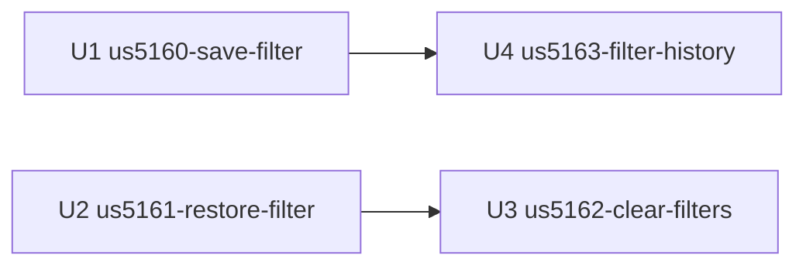

# Unit Dependencies — F1220 Remember my filter

This file describes topology only. Delivery Planning chooses the order of work.

## Dependency DAG

```yaml
units:
  - name: us5160-save-filter
    kind: service
    depends_on: []
  - name: us5161-restore-filter
    kind: ui
    depends_on: []
  - name: us5162-clear-filters
    kind: ui
    depends_on: [us5161-restore-filter]
  - name: us5163-filter-history
    kind: service
    depends_on: [us5160-save-filter]
```



Text version:

- U4 depends on U1: it extends U1's store and controller (ADR-001).
- U3 depends on U2: it changes U2's `FilterSession` and `QueueRenderer` (ADR-004).
- U1 and U2 have no unit dependencies. Both build against the agreed contract from Contract Design, which is not a unit.

The graph has no cycles.

## Integration Points

| From | To | How | Agreed in |
|---|---|---|---|
| U2 (`SavedFilterClient`) | U1 (`ReviewerFilterController`) | REST: GET/PUT `/reviewers/{reviewerId}/filter` | Contract Design |
| U2 (`SavedFilterClient`) | U1 (`TenantsController`) | REST: GET `/tenants` | Contract Design |
| U2 (`ApiClient`, unchanged) | existing `PendingRequestsController` | REST: GET `/requests/pending`, browser access opened by U1 (`BrowserAccessPolicy`) | Contract Design |
| U3 (`FilterSession`) | U1 (`ReviewerFilterController`) | REST: PUT the cleared filter, through U2's client | Contract Design |
| U4 (`ReviewerFilterStore`, `ReviewerFilterController`) | U1's code | Shared classes in `priorauth-api` (a code dependency, not a call between running services) | ADR-001 |
| Nurse manager | U4 | REST: GET `/reviewers/{reviewerId}/filter/history` | Contract Design |

There is no shared database, event or message queue between units (NFR1).

The cross-repo agreement rests on the example JSON that Contract Design keeps. Each unit copies the examples for its own calls into its repo's tests (Q1).

## Parallel Development

Several valid orders exist. These sets of units have no dependency between them:

- {U1, U2}: different repos, joined only by the contract.
- {U1, U3}, once U2 has merged.
- {U2, U4}, once U1 has merged.
- {U3, U4}, once their own dependencies have merged.

The team builds stories in parallel, with no first end-to-end slice (team practice: walking skeleton off). The stories are proven together at the feature's Build and Test.
