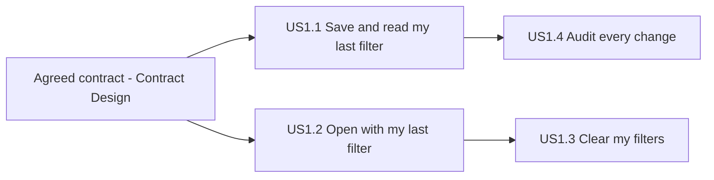

# User Stories — F1220 Remember my filter

One AI-DLC story per Rally story (questions Q2). Each Rally story is one unit, one branch and one PR. Requirement IDs come from `inception/requirements-analysis/requirements.md`. Personas are defined in `personas.md`. The designer, developer and quality engineer reviewed the draft, and their contributions are in `contributions/`. The three decisions their review raised are questions Q4-Q6.

**Additions made in this stage** (each has a documented origin):

- `GET /tenants` (Q4).
- The message when the queue can't load (Q5).
- FR1.3 narrowed so a reviewer id must contain at least one letter or digit (Q6).
- A loading text on open, until the saved filter is read. It traces to FR4.3: restore without showing the unfiltered queue first, raised by the designer's contribution.

Requirements Analysis is not reopened. These are recorded here and in `traceability.json` as User Stories decisions.

Reviewer ids such as `rita.k` and `new.one` in the criteria are examples. Tests use their own ids (team practice: independent tests).

| Story | Rally | Owner | Repo | Priority | Depends on |
|---|---|---|---|---|---|
| US1.1 Save and read my last filter | US5160 | Kiran Rao | priorauth-api | Must | — |
| US1.2 Open the screen with my last filter | US5161 | Divya Pillai | priorauth-web | Must | The agreed contract (Contract Design), not US1.1's merge |
| US1.3 Clear my filters | US5162 | Tara Joshi | priorauth-web | Should (slips first) | US1.2 (the same screen code) |
| US1.4 Audit every filter change | US5163 | Arjun Nair | priorauth-api | Must | US1.1 merged (it changes US1.1's store and save code) |

**Testing note (team practice):**

- **API criteria:** proved with JUnit and MockMvc.
- **Limit criteria:** tested against a fresh store instance with small configured limits, plus one HTTP test in its own context. They are never tested in the shared test context.
- **Screen criteria:** proved through DOM-free `src/` modules with an injected `fetchFn`. Markup criteria are checked on the rendered HTML string.
- **Keyboard and screen-reader behaviour:** checked by hand once at the feature's Build and Test, because the team has no browser tests.

---

## US1.1 Save and read my last filter (Rally US5160)

**As** Rita the Reviewer, **I want** my last queue filter kept for me and given back wherever I open the screen, **so that** I don't have to set it again on another computer.

**Priority:** Must · **Requirements:** FR1, FR2, FR3; NFR3, NFR4, NFR6, NFR7; Q4, Q6

**Acceptance criteria**

- **AC1.1.1 Save and read back.** Given reviewer `rita.k` has never saved, when `PUT /reviewers/rita.k/filter` is sent with `{"tenant": "TX-01", "overLimit": true}`, then the answer is 204, and `GET /reviewers/rita.k/filter` answers 200 with `{"tenant": "TX-01", "overLimit": true}`. (FR1.1, FR2.1)
- **AC1.1.2 Later save replaces.** Given `rita.k` saved `{"tenant": "TX-01", "overLimit": true}`, when she saves `{"tenant": null, "overLimit": false}`, then reading back returns `{"tenant": null, "overLimit": false}`. (FR1.1, FR1.5)
- **AC1.1.3 Nothing saved yet.** Given `new.one` has never saved, when `GET /reviewers/new.one/filter` is sent, then the answer is 200 with `{}`, and `new.one` does not take a reviewer slot. With the reviewer limit at 1, reading `new.one` and then saving as another new reviewer still succeeds. (FR2.2, FR1.4)
- **AC1.1.4 Unknown tenant refused.** Given `rita.k` saved `{"tenant": "TX-01", "overLimit": true}`, when she saves `{"tenant": "ZZ-99", "overLimit": false}`, then the answer is 400, and reading back still returns `{"tenant": "TX-01", "overLimit": true}`. (FR1.2, FR3.1)
- **AC1.1.5 Known tenants.** Given the sample export holds TX-01 and NM-02 requests, when `rita.k` saves `NM-02` or `TX-01`, then each is accepted. Saving `tx-01` is refused with 400, because tenant ids are case-sensitive. (FR3.1, FR3.2; A4)
- **AC1.1.6 Malformed bodies refused.** Given `rita.k` has a saved filter, when a save sends any of these, then each answers 400 and the saved filter is unchanged:
  - `{"overLimit": true}` (missing `tenant`)
  - `{"tenant": null}` (missing `overLimit`)
  - `{"tenant": null, "overLimit": false, "x": 1}` (extra field)
  - `{"tenant": null, "overLimit": "true"}` (string, not boolean)
  - `{"tenant": null, "overLimit": 1}` (number, not boolean)
  - `{"tenant": 5, "overLimit": false}` (number, not string)
  - unreadable JSON
  - a body of 1,025 bytes

  A valid body of exactly 1,024 bytes is accepted. (FR1.2, NFR3; the developer's contribution says Spring's defaults accept extra fields and convert types, so the API must turn that off for these bodies)
- **AC1.1.7 Invalid reviewer id refused.** Letters and digits mean ASCII only (`A-Z`, `a-z`, `0-9`). `PUT` and `GET` both answer 400 for:
  - an id with any other character (for example `rita k`, or `rené` with a non-ASCII `é`)
  - an id of 65 characters
  - an id with no letter or digit (for example `-_-`)

  A 64-character id is accepted. The ids `.` and `..` get 400 `invalid-reviewer-id` too (contract change of 2026-11-03: Spring Boot 4.1 does not reroute them). Nothing is saved for them. (FR1.3 narrowed by Q6; FR2.3)
- **AC1.1.8 Reviewer ids are case-sensitive.** Given `rita.k` saved TX-01, when `Rita.K` reads, then the answer is `{}`. They are different reviewers. (FR1.3)
- **AC1.1.9 Reviewer limit.** Given a fresh store with the reviewer limit at 2, and reviewers `a1` and `b1` have saved, when new reviewer `c1` saves, then the answer is a 4xx error whose message names the limit, and nothing is saved for `c1`. A further save by `a1` is still accepted. (FR1.4, NFR7; A3; Contract Design fixes the exact code, so this criterion is provisional until then)
- **AC1.1.10 Safe errors.** When any request to the new endpoints is refused, the error body has a short message and no stack trace. It contains neither the submitted tenant value nor the reviewer id from the path. For example, after saving `{"tenant": "<b>ZZ</b>", ...}`, the response text contains no `<b>`. (NFR4; Contract Design fixes the body shape, so this criterion is provisional until then)
- **AC1.1.11 Known tenants for the picker.** When `GET /tenants` is sent, then the answer is 200 with exactly the known tenants (TX-01 and NM-02 in the sample export) in a stable order. (Q4; FR3.1, FR4.6; Contract Design fixes the shape)
- **AC1.1.12 Browser calls from named origins.** Given the configured allowed origin (the screen's local development origin), a browser call from that origin to the new endpoints and to `GET /requests/pending` is allowed, including the `PUT` preflight. A call from any other origin is not allowed, and `*` is never answered. (NFR6; Q4)
- **AC1.1.13 Queue unchanged.** Given the new endpoints exist, when `GET /requests/pending?tenant=ZZ-99` is sent, then it still answers `200 []`. Adding the NM-02 request changes existing tests:
  - the row counts in the existing queue tests
  - any test whose `asOf` falls before the new request's `receivedAt`

  The NM-02 row's `receivedAt` is chosen on or before 2026-10-13, so no existing `asOf` case turns into a 400. US1.1's code plan names every test file it changes. Each changed file gets the happy path plus two edge cases (team practice). (FR3.2, FR3.3, NFR8)

**INVEST:** Independent (API only). Valuable: it is the base the screen restores from. Testable through the API.

**Size (Delivery Planning input):** US1.1 grew past its Rally estimate of 3 with `GET /tenants`, browser access, strict request bodies and the NM-02 test updates.

- Kiran Rao re-estimates it at Delivery Planning, which records the new estimate.
- If it no longer fits 2027.Q1 R1, the fallback is to split `GET /tenants` and browser access into a separate Rally story, which still comes before US1.2's screen work. Delivery Planning decides with Dana Ortiz.

**Hand-off to Contract Design:** AC1.1.9 and AC1.1.10 (and AC1.4.8, which follows AC1.1.10) are provisional. Contract Design must replace "a 4xx error" with the exact status code for the reviewer limit. It must also replace "a short message" with the exact error body shape, and update these criteria to match.

---

## US1.2 Open the screen with my last filter (Rally US5161)

**As** Rita the Reviewer, **I want** the queue to open with the filter I used last and to remember my changes, **so that** I don't pick it every morning.

**Priority:** Must · **Requirements:** FR4, FR5; NFR5, NFR10; A1; R-06; Q5

**Screen behaviour common to this story and US1.3:**

- There is one message area, a single element marked `role="status"` that screen readers announce. It shows at most one message at a time.
- A "wasn't saved" message is cleared by the next successful save.
- The "couldn't load" messages stay until the next successful load.

Messages are worded as statements of fact, for example:

- "Your saved filter couldn't be loaded, so all requests are shown."
- "Your filter wasn't saved. It will apply until you leave this page."
- "Open this page from your reviewer link to have your filter remembered."
- "The queue couldn't be loaded. Try again in a moment."
- "No requests match this filter."

The exact wording can change in code review.

**Acceptance criteria**

- **AC1.2.1 Filter controls on the page.** Given the screen is rendered, then:
  - The markup has a native `<select>` labelled "Tenant" (with `<label for>`). It offers "All tenants" plus exactly the tenants `GET /tenants` returns.
  - It has a native checkbox labelled "Over limit only".
  - Both are checked on the rendered HTML string.
  - Keyboard use is checked by hand at Build and Test.

  (FR4.2, FR4.6, NFR10; Q4)
- **AC1.2.2 Restore on open, without a flash.** Given Rita opens `?reviewer=rita.k`, and she has saved `{"tenant": "TX-01", "overLimit": true}`, when the screen loads, then:
  - It shows a loading text until the saved filter is read.
  - It then asks the queue for TX-01 over-limit requests, and the controls show TX-01 and the switch on.
  - The whole unfiltered queue is never shown first.

  (FR4.1, FR4.3)
- **AC1.2.3 Nothing saved opens unfiltered.** Given the saved filter is `{}` or `{"tenant": null, "overLimit": false}`, when the screen loads, then it shows the whole queue, as today, with "All tenants" selected and the switch off. (FR4.4)
- **AC1.2.4 Saved filter can't be read.** Given reading the saved filter fails (the API is unreachable, answers with an error, or answers 400 for the reviewer id), when the screen loads, then the whole queue still loads and the message area says the saved filter couldn't be loaded. (FR4.5, NFR10)
- **AC1.2.5 Change is applied and saved.** Given the screen is open for `rita.k`, when she picks NM-02, then the queue is asked for NM-02 requests and `{"tenant": "NM-02", "overLimit": false}` is saved for `rita.k`. (FR5.1)
- **AC1.2.6 Save fails.** Given a save fails, when Rita changes a control, then the queue keeps showing her new filter, and the message area says it wasn't saved. A later successful save clears that message. (FR5.2, NFR10)
- **AC1.2.7 Quick changes.** Given a stubbed API whose answers the test resolves by hand, when Rita makes three changes A, B and C while the save of A is still open, then:
  - Exactly two saves are sent, A and then C. B is never sent, and the stored filter is C.
  - When the queue answer for A arrives after the one for C, only C's rows are shown.

  (FR5.3)
- **AC1.2.8 A change before the saved filter arrives wins.** Given the saved-filter read on open has not answered, when Rita changes a control, then her change is applied and saved, and the read's later answer is ignored. (R-06, covered in this story's code plan by Divya Pillai)
- **AC1.2.9 No reviewer in the address.** Given the screen is opened without `?reviewer=`, then:
  - It shows the whole queue, and the controls still filter it.
  - Nothing is read or saved.
  - The message area says the filter won't be remembered.

  (A1)
- **AC1.2.10 Safe display.** Given the API returns a tenant id or label containing `<`, `>`, `&`, `"` or `'`, when it is shown in the picker, the table or a message, then it appears as text and is never interpreted as HTML. This is checked on the rendered string, for example `'` renders as `&#39;`. (NFR5)
- **AC1.2.11 No matching requests.** Given the queue answers `[]` for the current filter, then the table shows "No requests match this filter" and the count shows 0. (Corners: empty list)
- **AC1.2.12 The queue can't be loaded.** Given `GET /requests/pending` fails, then the message area says the queue couldn't be loaded, and "No requests match this filter" is not shown. The controls stay usable, and the next change tries again. (Q5)

**INVEST:** Depends only on the agreed contract, so it can start before US1.1 merges. It is valuable on its own. It is the largest story because the controls F1210 never added to the page come first (FR4.2). The team kept it as one story (Q2). Its logic for ordering saves, ignoring late reads and choosing messages lives in DOM-free `src/` modules, so every criterion except keyboard use is automated.

---

## US1.3 Clear my filters (Rally US5162)

**As** Rita the Reviewer, **I want** one control that clears the tenant and the over-limit switch, **so that** I see the whole queue again without unpicking each control.

**Priority:** Should (slips first if 2027.Q1 R1 is at risk) · **Requirements:** FR6; NFR10

**Acceptance criteria**

- **AC1.3.1 Clear everything.** Given Rita has TX-01 and the switch on, when she uses "Clear filters", then the picker shows "All tenants", the switch is off, the whole queue is shown, and `{"tenant": null, "overLimit": false}` is saved for her. (FR6.1)
- **AC1.3.2 Disabled when nothing is set.** Given the picker shows "All tenants" and the switch is off, then "Clear filters" is a native `<button>` with the `disabled` attribute. This is checked on the rendered HTML. (FR6.2, NFR10)
- **AC1.3.3 Enabled again.** Given "Clear filters" is disabled, when Rita sets any filter, then the button is rendered without `disabled`. (FR6.2)
- **AC1.3.4 Clear but save fails.** Given a save fails, when Rita uses "Clear filters", then the whole queue is shown and the message area says it wasn't saved. (FR6.3)
- **AC1.3.5 Focus after clearing.** Given Rita uses "Clear filters" from the keyboard, then focus moves to the Tenant picker, because the button has just become disabled. This is checked by hand at Build and Test. (NFR10)
- **AC1.3.6 Clear while a save is open.** Given a save of TX-01 is still open, when Rita uses "Clear filters", then the cleared filter is the one sent last and stored, following the same ordering rule as AC1.2.7. (FR5.3, FR6.1)

**INVEST:** Small (Rally: 1). Depends on US1.2's controls, because it changes the same screen code. Valuable on its own once they exist.

---

## US1.4 Audit every filter change (Rally US5163)

**As** Nina the Nurse Manager, **I want** a record of who changed their filter to what and when, **so that** I can tell why a reviewer didn't see a request.

**Priority:** Must · **Requirements:** FR1.5, FR7; NFR4, NFR7, NFR9

**Acceptance criteria**

- **AC1.4.1 One line per save.** Given the test clock reads `2027-01-12T09:15:30.900Z`, when `rita.k` saves `{"tenant": "TX-01", "overLimit": true}`, then her history gains exactly one line, `{"at": "2027-01-12T09:15:30Z", "reviewer": "rita.k", "tenant": "TX-01", "overLimit": true}`. The time is in UTC, cut to the second, not rounded. `reviewer` is the reviewer id the save was made under, the id in the path, not proof of who made it. Every history line has these four fields. (FR7.1, FR7.3, NFR9; requirements A2)
- **AC1.4.2 Clears and repeats count.** Given `rita.k` saved TX-01 with the switch on, when she saves the same filter again and then `{"tenant": null, "overLimit": false}`, then two more lines are written. (FR7.1)
- **AC1.4.3 Refused saves leave no line.** When a save is refused for any reason (unknown tenant, any malformed body from AC1.1.6, an invalid reviewer id, or the reviewer limit), then no history line is written, and the history reads the same as before. (FR7.2)
- **AC1.4.4 Newest first.** Given `rita.k` saved three times, two of them in the same second, when `GET /reviewers/rita.k/filter/history` is sent, then the answer is 200 with three lines, newest first. The two same-second lines keep the order they were saved in, newest first. (FR7.3)
- **AC1.4.5 Empty and invalid.** Given `new.one` has never saved, then the history answers `[]`, and `new.one` takes no reviewer slot. An invalid reviewer id answers 400. (FR7.4, FR1.4)
- **AC1.4.6 Only the newest lines are kept.** Given a fresh store with the history limit at 3, when `rita.k` saves five times, then her history holds exactly the 3 newest lines. (FR7.5, NFR7; A3)
- **AC1.4.7 Saves at the same moment stay consistent.** Given N saves for `rita.k` sent at the same moment, then:
  - Her history gains exactly N lines.
  - Her saved filter equals the newest history line.
  - No line exists without its save, and no save exists without its line.

  (FR1.5, NFR2)
- **AC1.4.8 Safe errors.** When a history request is refused, the error body follows AC1.1.10. (NFR4)
- **AC1.4.9 Read through the API only.** The history is read through `GET /reviewers/{reviewerId}/filter/history`. No screen view is added. (FR7.6)

**How Nina reads it in F1220:**

- Nina, or someone acting for her, calls `GET /reviewers/{reviewerId}/filter/history` directly. The release notes, written by Meena Iyer, name that call with an example next to the history's limits.
- At the feature demo the value is shown by making that call. The story's value is enabling: there is no screen view for Nina until a later feature adds one. (RQ9; requirements A2)

**INVEST:** Its branch is cut only after US1.1 merges into `feature/F1220`, because it changes US1.1's store and save code. API only. Small (Rally: 2). Testable through the API with a controlled clock.

---

## Dependencies

Text version:

- US1.1 and US1.2 both start from the agreed contract and can be built in parallel.
- US1.4 starts after US1.1 has merged.
- US1.3 follows US1.2.

## Cross-Repo Check

Each repo is tested against stubs, so no automated test proves the API and the screen agree. Contract Design should keep example JSON for each call, which both repos' tests use. The feature's Build and Test runs one manual check end to end: open the screen with `?reviewer=`, change the filter, reload, and read the history. (Quality contribution)

## Deferred to Later Stages

These requirements are not user-visible, so they are carried by design rather than by stories (Q3):

- NFR1 data lifetime and the replaceable store
- NFR2 atomic save plus history line. AC1.4.7 proves it, and NFR Design decides how.
- NFR8 compatibility baseline
- NFR11 coverage reporting
